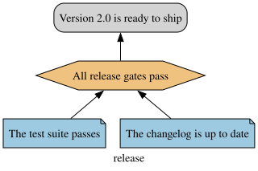
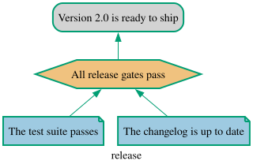
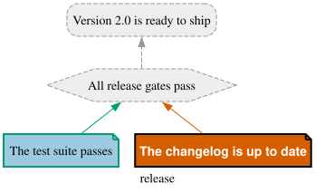

Back in [jPipe 101](/tutorials/jpipe101/) you wrote the `release` argument: the conclusion *"Version
2.0 is ready to ship"*, argued by the strategy *"All release gates pass"*, resting on two facts,
*"The test suite passes"* and *"The changelog is up to date"*.

<div align="center">

</div>

As drawn, the argument only *asserts* those facts. To actually **validate** it, you would check them
by hand: to trust *"The test suite passes"*, you would open the test report and see no failure; to
trust *"The changelog is up to date"*, you would open `CHANGELOG.md` and confirm it has an entry for
this release. If both facts hold, the strategy *"all gates pass"* holds with them, and the conclusion
follows: the version is ready to ship. If either fact fails, the argument falls with it.

This tutorial automates that exact reasoning. You will attach to each claim a small piece of Python
that runs the real check, then let the [jPipe Runner](/tutorials/install/runner/) walk the argument
for you, bottom-up, and report what actually held.

The idea will feel familiar if you have used a behaviour- or keyword-driven test framework. In
[Cucumber](https://cucumber.io/), each plain-language `Given/When/Then` step is glued to a
step-definition function; in [Robot Framework](https://robotframework.org/), each human-readable
keyword maps to a Python implementation. jPipe applies the same idea to an assurance case: every
node's claim is a sentence, and you supply the code that decides whether that sentence is true.

This tutorial assumes the [Runner is installed](/tutorials/install/runner/) (version 4), along with
the [compiler](/tutorials/install/compiler/) (version 3 or later, to write the skeleton below), and
that you have the [release model from jPipe 101](/tutorials/jpipe101/).
{: .notice--info}

# Two files: the model and its checks

A justification and its verification live in two files:

- the **model** (`release.jd`): *what* you claim and how it is argued;
- a **step library** (a `.py` file): *how* each claim is checked.

The runner matches them up by element id, runs the checks bottom-up (evidence, then strategy, then
conclusion), and reports, for every element, whether it held.

# Step 1: Compile the model to the runner's input format

The runner does not read `.jd` directly; it consumes a **compiled JSON**. This JSON is jPipe's
**interchange format**: the compiler emits it, the runner reads it, and other tools can produce or
consume it too, so the language front-end stays decoupled from whatever executes or analyses the
argument. Keep the files the runner needs apart from your model, in a `run/` folder:

```
$ mkdir run
$ jpipe process -i release.jd -m release -f JSON -o run/release.jd.json
```

# Step 2: Scaffold the step library

You could write the Python by hand, but the compiler writes a skeleton for you: one function per
element, already wired with the right decorator:

```
$ jpipe process -i release.jd -m release -f PYTHON -o run/release_steps.py
```

```python
# run/release_steps.py
from jpipe_runner import Fail, Outcome, Pass, conclusion, evidence, strategy

@evidence("release:tests", observes={}, produces=[])
def the_test_suite_passes() -> Outcome:
    """[evidence] The test suite passes"""
    raise NotImplementedError("release:tests is not implemented yet")


@evidence("release:changelog", observes={}, produces=[])
def the_changelog_is_up_to_date() -> Outcome:
    """[evidence] The changelog is up to date"""
    raise NotImplementedError("release:changelog is not implemented yet")


@strategy("release:gates", consumes=[], produces=[])
def all_release_gates_pass() -> Outcome:
    """[strategy] All release gates pass"""
    raise NotImplementedError("release:gates is not implemented yet")


# The runner concludes this claim from what supports it unless it is bound. Uncomment to check it.
# @conclusion("release:ready", consumes=[])
# def version_2_0_is_ready_to_ship() -> Outcome:
#     """[conclusion] Version 2.0 is ready to ship"""
#     raise NotImplementedError("release:ready is not implemented yet")
```

Each element kind has its decorator: `@evidence`, `@strategy`, `@sub_conclusion` and `@conclusion`.
Its first argument is the id of the element the function checks, written `<model>:<id>`: the
`tests` evidence of the `release` justification is `release:tests`. This is where the meaningful ids
of jPipe 101 pay off: the library reads like the argument it checks. The function's name, taken from
the label, is only for you; the runner binds by id.

# Step 3: Ask the runner what is left to do

Before writing a line, run the skeleton through a **dry run**. It checks that the library fits the
model, and calls no function:

```
$ jpipe-runner --dry-run --library run/release_steps.py run/release.jd.json
Justification: release
  Version 2.0 is ready to ship

JP012 error [release:tests]: the evidence release_steps.the_test_suite_passes produces nothing
  fix: Produce what the evidence observed, and consume it in its strategy.
JP012 error [release:changelog]: the evidence release_steps.the_changelog_is_up_to_date produces nothing
  fix: Produce what the evidence observed, and consume it in its strategy.
JP018 error [release:tests]: the evidence release_steps.the_test_suite_passes observes no artifact, so it checks nothing in the world
  fix: Declare what it observes: observes={"name": "path/to/artifact"}.
JP018 error [release:changelog]: the evidence release_steps.the_changelog_is_up_to_date observes no artifact, so it checks nothing in the world
  fix: Declare what it observes: observes={"name": "path/to/artifact"}.

4 diagnostics (4 errors)
verdict: invalid (nothing ran)
```

The runner refuses to run, and its four errors are your to-do list. Each has a code (the
[runner's rule reference](https://github.com/jpipe-mcscert/jpipe-runner/blob/main/docs/rules.md)
explains every one) and a fix. They name the two ideas at the heart of a step library: evidence
**observes** something in the world, and it **produces** what it found for the reasoning above it.

# Evidence observes the world

A piece of evidence is a claim *about something*: here, a test report and a changelog. The runner
makes you say what that something is. `observes` maps a parameter of the function to a file (or a
glob of files), relative to the directory you run the runner from. Before calling the function, the
runner checks that the file is there, records its SHA-256 and size, and hands it to the function as a
`Path`. An evidence that observes nothing checks nothing, which is why the dry run rejected the
skeleton.

To keep the example runnable, we stand in for the real artifacts with **mock evidence** in a `mock/`
folder. Save this test report, with no failure, as `mock/junit.xml`:

```xml
<?xml version="1.0" encoding="UTF-8"?>
<testsuite name="release" tests="42" failures="0" errors="0" skipped="0">
  <testcase classname="release" name="test_release_builds"/>
</testsuite>
```

and this changelog as `mock/CHANGELOG.md`:

```markdown
# Changelog

## 2.0

- Version 2.0 ships.
```

In a real project, the evidence would observe the report your test runner writes and the
repository's own `CHANGELOG.md`.

# The data-flow contract

Evidence sits at the bottom of the argument; the strategy above it reasons over what the evidence
found. The decorators declare how those facts travel *up* the argument, by name:

- a piece of **evidence** declares what it `produces`, and returns those values with its outcome;
- a **strategy** declares what it `consumes`, and receives each value as the parameter of the same
  name. It may itself `produce` values for the node above it.

The *order* in which elements run is fixed by the argument itself: a piece of evidence always runs
before the strategy it supports, which runs before the conclusion. The names are what move **data**
along that structure.

Structure and data flow must agree, and the runner **enforces** it before anything runs: every
evidence must produce a value that a step above it consumes, and every value a step consumes must be
produced by a step that supports it, directly or not. A typo in a variable name is a dry-run error,
not a surprise in production.

# Step 4: Implement the checks

Now fill in the bodies:

```python
# run/release_steps.py
from pathlib import Path
from xml.etree import ElementTree

from jpipe_runner import Fail, Outcome, Pass, evidence, strategy

RELEASE = "2.0"


@evidence("release:tests", observes={"report": "mock/junit.xml"}, produces=["tests_pass"])
def the_test_suite_passes(report: Path) -> Outcome:
    """[evidence] The test suite passes"""
    suite = ElementTree.parse(report).getroot()
    failed = int(suite.get("failures", "0")) + int(suite.get("errors", "0"))
    if failed == 0:
        return Pass(tests_pass=True)
    return Fail(f"{failed} tests failed")


@evidence("release:changelog", observes={"changelog": "mock/CHANGELOG.md"}, produces=["changelog_ok"])
def the_changelog_is_up_to_date(changelog: Path) -> Outcome:
    """[evidence] The changelog is up to date"""
    if f"## {RELEASE}" in changelog.read_text(encoding="utf-8"):
        return Pass(changelog_ok=True)
    return Fail(f"the changelog has no entry for {RELEASE}")


@strategy("release:gates", consumes=["tests_pass", "changelog_ok"])
def all_release_gates_pass(tests_pass: bool, changelog_ok: bool) -> Outcome:
    """[strategy] All release gates pass"""
    if tests_pass and changelog_ok:
        return Pass()
    return Fail("a release gate did not pass")
```

Every function returns an **outcome**, imported from `jpipe_runner`:

- **`Pass(...)`**: the claim holds. It carries the values the step declared it `produces`, here
  `Pass(tests_pass=True)`.
- **`Fail(reason)`**: the claim does not hold, and the reason says why, in words a reviewer can act
  on.
- **`Skip(reason)`**: the check cannot be judged right now (say, the report is only produced on the
  release branch). A skipped element stops what it supports, just as a failed one does.

The conclusion is gone from the library: a **conclusion** is the very claim the strategy beneath it
establishes, so left unbound it holds exactly when what supports it holds. You *may* bind one (the
skeleton left it commented out for that purpose); the runner then calls it last, once everything
below it has passed, as a final cross-check. The same goes for a **sub-conclusion**, a handy place
for an extra check partway up a larger argument.

Run the dry run again: with every evidence observing and producing, and the strategy consuming what
they produce, the library now fits the model.

```
$ jpipe-runner --dry-run --library run/release_steps.py run/release.jd.json
Justification: release
  Version 2.0 is ready to ship

verdict: valid (a dry run: no step was called)
```

# Step 5: Run it

Run the justification from the folder that holds `run/` and `mock/`, since the paths the evidence
observes are relative to it. `--diagram` also draws the argument with the run over it, in a format
named by the file's suffix:

```
$ jpipe-runner --library run/release_steps.py --diagram out/release.svg run/release.jd.json
Justification: release
  Version 2.0 is ready to ship

  ✔ Evidence    The test suite passes         # release:tests
  ✔ Evidence    The changelog is up to date   # release:changelog
  ✔ Strategy    All release gates pass        # release:gates
  ✔ Conclusion  Version 2.0 is ready to ship  # release:ready

4 elements (4 passed)
diagram: out/release.svg
verdict: pass
```

The report reads like a Cucumber run: one line per element, in the order they ran, ending with the
**verdict**. The diagram is your justification, *verified*: a green border on every element that
held.

<div align="center">

</div>

`out/` holds what a run writes (diagrams, reports), so keep it out of version control with an
`out/` line in your `.gitignore`. The `run/` folder, on the other hand, is part of your project.
{: .notice--info}

# When a check fails

Now make one of the mocks stale. Pretend you cut release `2.0` but forgot the changelog, whose newest
entry is still `1.9`:

```
$ echo "## 1.9" > mock/CHANGELOG.md
$ jpipe-runner --library run/release_steps.py --diagram out/release.svg run/release.jd.json
Justification: release
  Version 2.0 is ready to ship

  ✔ Evidence    The test suite passes         # release:tests
  ✘ Evidence    The changelog is up to date   # release:changelog
      release_steps.the_changelog_is_up_to_date: the changelog has no entry for 2.0
      observed mock/CHANGELOG.md (sha256 8db77e12b54f…, 7 bytes)
  - Strategy    All release gates pass        # release:gates
      not run: release:changelog did not pass
  - Conclusion  Version 2.0 is ready to ship  # release:ready
      not run: release:changelog did not pass

4 elements (1 failed, 2 skipped, 1 passed)
diagram: out/release.svg
verdict: fail
```

The failed evidence says why, in the words of its `Fail`, and names the exact file it judged, down to
its hash. Everything above it is **skipped**, not called: the strategy would need `changelog_ok`,
which the failed evidence never produced. Each skipped element names the element that stopped it,
however far below.

The diagram makes the break obvious: the failed evidence is filled in vermillion, and the strategy
and conclusion that rested on it are dashed and greyed out. You see at a glance both what failed and
how far the damage spread.

<div align="center">

</div>

Skipping the elements above, rather than failing them, keeps the report honest: jPipe never claims
*"the release is ready"* held when the evidence beneath it never ran. Put the `## 2.0` entry back in
`mock/CHANGELOG.md` before moving on.

# Exit codes: a verdict a pipeline can act on

The runner's exit code says how the run ended, so a script or a CI job can act on it without reading
the report:

| Code | Meaning |
|------|---------|
| `0` | The justification holds (or a dry run found the library valid). |
| `1` | The justification does not hold. |
| `2` | The command line is wrong. |
| `3` | Nothing could run: the model was refused, a library could not be imported, or validation failed. |
| `4` | A file could not be read or written. |

A mistake *in* a step is not a crash of the runner: a step that raises an exception fails its element,
with the traceback from your own code, and the run goes on, so one run reports every broken step.

# Where to next?

- **[Run it in CI/CD](/tutorials/cicd/)**: have every change checked automatically, and catch a stale
  changelog before it ships.
- **[What a change reaches](/tutorials/impact/)**: since every evidence declares the files it
  observes, the runner can tell which claims a change puts in question, without running anything.
- **[Run a composed argument](/tutorials/composed-runs/)**: run the libraries written for separate
  arguments together, on the argument `refine` or `assemble` builds from them.

The runner's own documentation goes further: the
[step library reference](https://github.com/jpipe-mcscert/jpipe-runner/blob/main/docs/authoring.md),
the [command line](https://github.com/jpipe-mcscert/jpipe-runner/blob/main/docs/cli.md), and the
[JSON report](https://github.com/jpipe-mcscert/jpipe-runner/blob/main/docs/report-schema.md) that
programs read instead of the text one.
