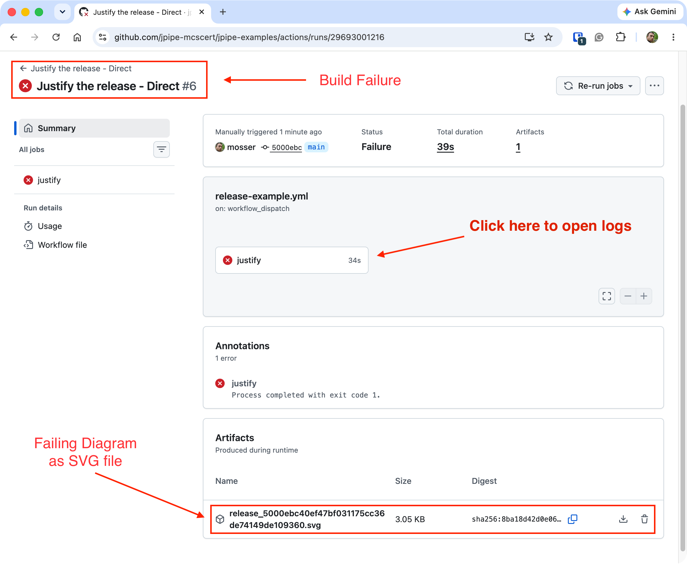
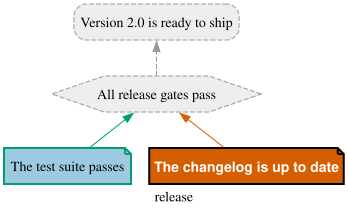
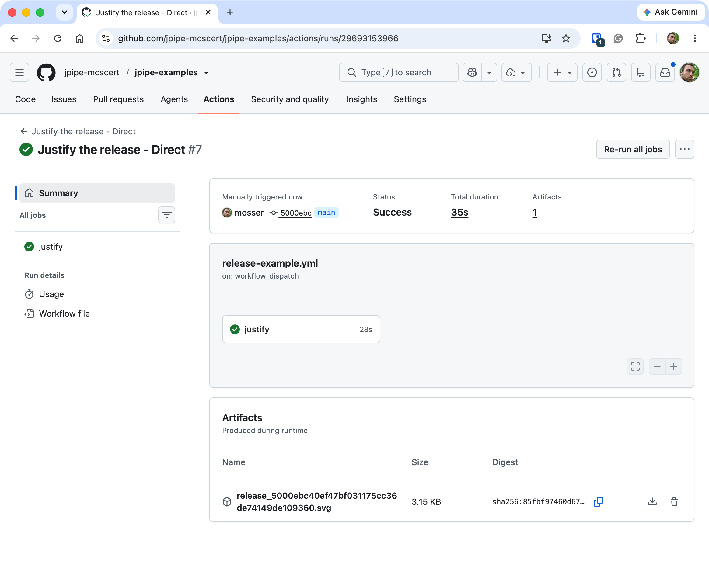

A justification is a snapshot of a decision: *at the moment you wrote it*, every claim held. But code,
dependencies, and documents keep moving, and a fact you validated long ago can quietly stop being
true. That is **decision drift**: the argument still *looks* fine on the page, yet one of its claims no
longer holds, and the conclusion it once supported is now in jeopardy with nobody noticing.

The cure is to stop trusting the drawing and re-check the argument **against reality, automatically**.
The **jPipe CI** action runs the [Runner](/tutorials/runner/) in your GitHub Actions pipeline, so the
whole justification is re-validated whenever you ask, and a drifted claim surfaces as a failed check
instead of a silent lie.

This builds on the [Runner tutorial](/tutorials/runner/): commit its compiled model
(`run/release.jd.json`), its step library (`run/release_steps.py`) and its mock evidence (`mock/`) to
the repository.
{: .notice--info}

# The workflow

Create `.github/workflows/jpipe.yml`. Any regular GitHub Actions trigger works here, a `push`, a
`pull_request`, a schedule, so the justification can be re-validated on whatever event matters to you
(we wire those up [at the end](#from-demo-to-guardrail)). For this demonstration, though, we trigger
it **by hand** with `workflow_dispatch`. One input, the version the changelog announces, stands in for
the state of your changelog, so you can reproduce a stale one and then fix it:


```yaml
name: Justify the release

on:
  workflow_dispatch:
    inputs:
      changelog_version:
        description: "Version the changelog announces (1.9 is stale, 2.0 matches the release)"
        default: "1.9"

permissions:
  contents: read

jobs:
  justify:
    runs-on: ubuntu-latest
    steps:
      - name: Checkout repository
        uses: actions/checkout@v7

      - name: Prepare the mock changelog
        env:
          CHANGELOG_VERSION: ${{ inputs.changelog_version }}
        run: echo "## $CHANGELOG_VERSION" > mock/CHANGELOG.md

      - name: Run the jPipe justification
        uses: jpipe-mcscert/jpipe-ci-actions@1.0.0
        with:
          justification: run/release.jd.json
          library: run/release_steps.py
```


The workflow's real work is its **last step**: it runs the jPipe CI action, which installs the
runner, executes your justification against its step library from the repository's root (where the
paths the evidence observes start), and re-checks every claim. The job fails with the runner's
[exit code](/tutorials/runner/#exit-codes-a-verdict-a-pipeline-can-act-on) when the justification
does not hold. Either way, the action writes a summary of the run on the job's page and uploads the
reports and the diagram as a build artifact. It needs only the model and the step library you
committed (`justification` and `library`); `library` takes one file per line, or a glob, when the
checks are split across several.

The middle step exists **only for this demonstration**: it overwrites `mock/CHANGELOG.md` with the
version you chose, standing in for a changelog someone forgot to update. In a real project you would
**delete that step**: the changelog already lives in the repository, and the action checks it as it
is.

# A stale changelog fails the build

Picture the everyday slip: you cut the `2.0` release and commit the code, but forget to update the
changelog, so it still announces the previous version. Push the workflow, open the repository's
**Actions** tab, choose *Justify the release*, click **Run workflow**, and launch it with
`changelog_version` on its stale `1.9`. The changelog never mentions `2.0`, the claim that the
release is ready is no longer backed by evidence, and the run finishes red:

<!-- CAPTURE-SS: build_fail.png, the failed run with the jPipe CI action -->
**📸 Screenshot needed:** recapture the GitHub Actions run summary marked as a **Failure**, the
`justify` job in red, from a run of the jPipe CI action.
{: .notice--warning}


GitHub marks the whole run a **Failure**: the `justify` job exits with code 1, the code the runner
returns when the justification does not hold.

# Reading the failure

You do not need to dig through logs to find out *which* claim broke. Scroll down the run's page to
the job's **summary**, which the action writes for you. It opens with the verdict, then lists every
element that did not pass, and why: *"The changelog is up to date"* (`release:changelog`) failed,
because *the changelog has no entry for 2.0*, so the strategy and the conclusion above it were not
run. Below it, the full text report is one click away.

<!-- CAPTURE-SS: summary.png, the job summary of the failed run -->
**📸 Screenshot needed:** the job summary of the failed run: the headline *"✘ The justification
`release` does not hold (exit code 1)"*, and the table listing `release:changelog` (*the changelog has
no entry for 2.0*) and the two elements above it (*not run: release:changelog did not pass*).
{: .notice--warning}


The artifact saved with the run holds the reports (the text one, and the JSON one for programs) and
the diagram, which says the same thing at a glance: the failing evidence in vermillion and everything
that rested on it greyed out.

<div align="center">

</div>

# Fixing the drift

The fix is exactly what the argument asked for: update the changelog to name the release you are
shipping. Run the workflow again, this time with `changelog_version` set to `2.0`. The evidence holds,
every gate passes, and the run goes green:

<!-- CAPTURE-SS: build_success.png, the green run with the jPipe CI action -->
**📸 Screenshot needed:** recapture the GitHub Actions run summary marked as a **Success** after
running with `changelog_version` set to `2.0`, with the job summary reading *"✔ The justification
`release` holds (exit code 0)"*.
{: .notice--warning}


That round trip, a red build, one glance at the summary, a one-line fix, then a green build, is the
whole point: the pipeline turned a silent decision drift into a loud, actionable failure.

# From demo to guardrail

To turn this into a standing guardrail, check the real artifacts on real changes:

1. **Point the evidence at the real files.** In `run/release_steps.py`, the changelog evidence
   observes `CHANGELOG.md` instead of `mock/CHANGELOG.md`, and the test evidence observes the report
   your test runner writes (for instance `build/junit.xml`).
2. **Produce what the evidence observes.** A test report only exists once the tests have run, so run
   them in a step before the action (for instance `pytest --junitxml=build/junit.xml`). Delete the
   mock step.
3. **Trigger on real changes:**

   ```yaml
   on:
     pull_request:
       branches: [main]
     push:
       branches: [main]
   ```

Now every push and pull request re-validates the whole justification against the actual repository. A
drifted claim turns the check red, exactly the failure you triggered by hand, now caught automatically
on every change.

Do your checks import packages (a YAML parser, your project's own code)? They run on the Python the
action runs the runner with: install those packages in an earlier step, and pass that interpreter to
the action with its `python-executable` input.
{: .notice--info}

# Where to next?

- **[Pull request integration](/tutorials/pull-requests/)** posts the result right on the pull
  request, so reviewers read the argument's live status where the change is discussed.
- **[What a change reaches](/tutorials/impact/)** tells, before anything runs, which claims a pull
  request puts in question.

Every input and output of the action is described in its
[reference](https://github.com/jpipe-mcscert/jpipe-ci-actions#readme).
