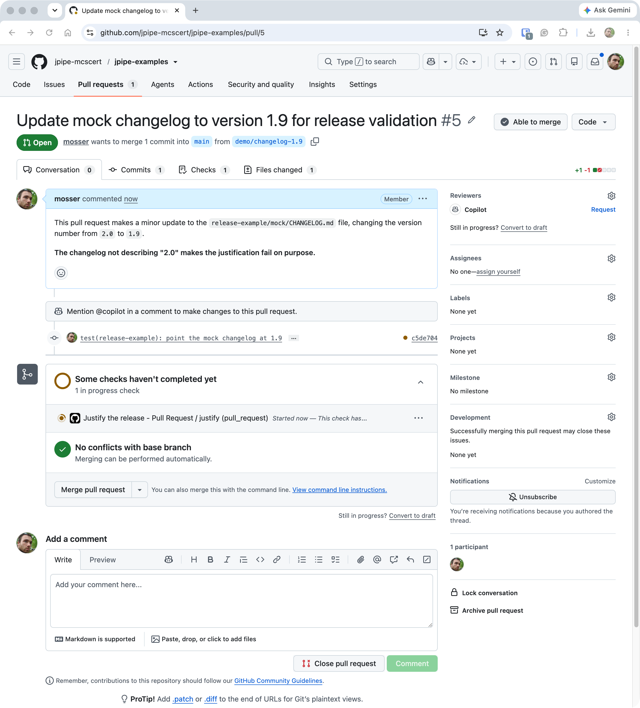
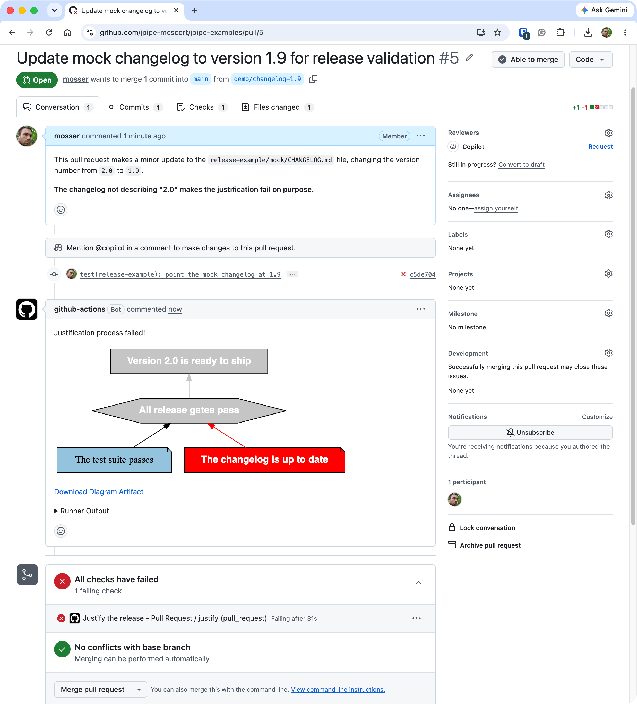
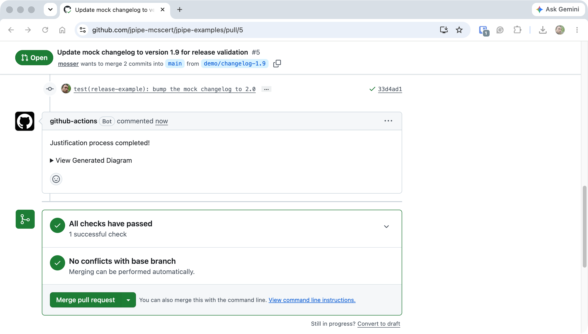

The [CI/CD workflow](/tutorials/cicd/) already re-validates the justification on every change and turns
the check red when a claim drifts. But that red mark lives in the **Actions** tab, off to the side of
where the work actually happens. On a team, a change arrives as a **pull request**, and the pull
request is where it is discussed, reviewed, and approved.

So the point of wiring jPipe into pull requests is this: a failing justification becomes **part of the
conversation**. Instead of a bare red check someone has to go hunting for, the coloured diagram is
posted right into the PR, so the broken claim sits in the discussion, next to the change that caused
it, for every reviewer to see.

This continues the [CI/CD tutorial](/tutorials/cicd/): the same model and step library, and the same
stale-changelog drift, now delivered through a pull request.
{: .notice--info}

# The workflow

Trigger on pull requests, and switch `embed-image` on. There is no mock step this time: the pull
request carries the changelog itself, stale or not (in this demonstration, the `mock/CHANGELOG.md`
the step library observes; in your project, the real one).


```yaml
name: Justify the release

on:
  pull_request:
    branches: [main]

permissions:
  contents: write        # push the rendered diagram to a branch
  pull-requests: write   # comment on the pull request

jobs:
  justify:
    runs-on: ubuntu-latest
    steps:
      - name: Checkout repository
        uses: actions/checkout@v7

      - name: Run the jPipe justification
        uses: jpipe-mcscert/jpipe-ci-actions@1.0.0
        with:
          justification: run/release.jd.json
          library: run/release_steps.py
          embed-image: true
```


Three things change from the [CI/CD job](/tutorials/cicd/):

- **`on: pull_request`** runs the justification on every pull request against `main`, and again on
  each new commit pushed to the branch. On a pull request, the action **comments** with the result,
  on top of the job summary you already know.
- **`embed-image: true`** shows the diagram *inside* that comment. GitHub only displays images it can
  fetch anonymously, and a build artifact needs a login, so the action commits the diagram to a
  branch of its own (`jpipe-runner-diagrams` by default) and links it from there.
- the **`permissions`** block lets the job's built-in token do both: `contents: write` to commit the
  diagram to that branch and `pull-requests: write` to leave the comment.

# The argument joins the review

Open a pull request that ships `2.0` but leaves the changelog on the previous version, the same drift
from the CI/CD tutorial, now on a branch under review. GitHub starts the check right away:



When it finishes, the justification has failed, and the jPipe CI action posts the result as a
comment from the `github-actions` bot. It opens with the verdict, *"✘ The justification `release`
does not hold"*, then lists each element that did not pass with the reason its check gave: *"The
changelog is up to date"* failed because *the changelog has no entry for 2.0*, and the strategy and
conclusion above it were not run. The diagram follows, the changelog evidence in vermillion and
everything above it greyed out, and the full text report sits folded at the bottom. The pull
request's check is red, and *"All checks have failed"* holds the merge box shut:

<!-- CAPTURE-SS: failure.png, the jPipe CI bot comment on a failing pull request -->
**📸 Screenshot needed:** recapture the `github-actions` comment posted by the jPipe CI action on the
failing pull request: the *"does not hold"* headline, the table of elements that did not pass, the
embedded diagram, and the red checks in the merge box.
{: .notice--warning}


The broken claim is part of the discussion now, not a red mark buried in the Actions tab. A reviewer
sees exactly which fact failed, and why, without leaving the page, and the comment links the artifact
holding the reports and the diagram.

# Fixing it in the open

Push a commit to the branch that bumps the changelog to name `2.0`. The action re-runs on the new
commit and comments again, this time *"✔ The justification `release` holds"*, the check turns green,
and the merge box clears:

<!-- CAPTURE-SS: success.png, the jPipe CI bot comment after the fix -->
**📸 Screenshot needed:** recapture the pull request after the fix: the new `github-actions` comment
reading *"✔ The justification `release` holds (exit code 0)"* with the all-green diagram, and every
check passing.
{: .notice--warning}


Because it all played out on the pull request, the record is complete: the conversation shows the
argument breaking, the commit that answered it, and the justification passing, all before anything
merged.

# Block the merge on a broken argument

The check's status follows the justification, so make it **required** in your repository's branch
protection rules (*Settings → Branches*). GitHub then refuses to merge a pull request whose argument
is red: a change cannot land until its justification holds again.

A pull request opened from a **fork** gets a read-only token, whatever the `permissions` block says,
so the action cannot comment on it. The check still runs, still fails the job, and the job summary
still says why.
{: .notice--info}

# Where to next?

- **[What a change reaches](/tutorials/impact/)** adds the reviewer's other question: which claims
  does this pull request touch at all?
- Make the argument itself more reusable with **[templates](/tutorials/templates/)** and the
  composition operators (**[assemble](/tutorials/assemble/)**, **[refine](/tutorials/refine/)**).

Every input and output of the action, including where the diagram is committed, is described in its
[reference](https://github.com/jpipe-mcscert/jpipe-ci-actions#readme).
