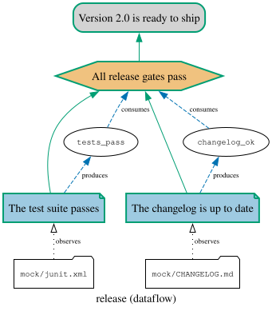

Running the whole justification on every change answers *"does the argument still hold?"*. Two
other questions come up just as often, and are cheaper to answer:

- **Before** running anything: *which claims does this change touch?* A reviewer looking at a pull
  request wants to know whether it is a typo fix or a change to something the release argument rests
  on.
- **After** a green run: *does that run still hold?* A justification checked last Tuesday says
  nothing about today, unless you can tell that nothing it looked at has moved since.

The runner answers both, because of one rule you met in the [Runner tutorial](/tutorials/runner/):
every piece of evidence declares the files it **observes**. The argument knows exactly what it looks
at, so it can tell what a change reaches.

This continues the [Runner tutorial](/tutorials/runner/): the same `release` model, step library and
mock evidence, in a git repository whose `.gitignore` holds `out/`, with everything committed on
`main`.
{: .notice--info}

# What the argument watches

Run the justification once more, with two new outputs. `--dataflow` draws the argument together with
everything its steps declare, and `--report` writes the **JSON report** of the run, the
machine-readable record of what happened:

```
$ jpipe-runner --library run/release_steps.py --report out/report.json --dataflow out/dataflow.svg run/release.jd.json
Justification: release
  Version 2.0 is ready to ship

  ✔ Evidence    The test suite passes         # release:tests
  ✔ Evidence    The changelog is up to date   # release:changelog
  ✔ Strategy    All release gates pass        # release:gates
  ✔ Conclusion  Version 2.0 is ready to ship  # release:ready

4 elements (4 passed)
dataflow: out/dataflow.svg
verdict: pass
```

The dataflow diagram is the argument seen from below. Each evidence hangs from the file it observes,
and each value it produces travels up to the strategy that consumes it:

<div align="center">

</div>

This is the map the rest of this tutorial reads. A variable that nobody produces, or nobody consumes,
or that two steps produce, would be drawn in vermillion: the dataflow view is also a quick way to
review a step library. Add `--dry-run` and it is drawn from the declarations alone, without calling
any step.

# Which claims does this change touch?

Start a branch and polish the documentation: a line in the changelog, a line in the README.

```
$ git checkout -b docs
$ echo "- Thanks to every contributor." >> mock/CHANGELOG.md
$ echo "See CHANGELOG for what is new." >> README.md
$ git commit -am "Polish the docs"
```

`jpipe-runner impact` lists the evidence whose observed files changed, and every element above it.
`--since` takes the changes from git, against any revision (a branch, a tag, a commit):

```
$ jpipe-runner impact --library run/release_steps.py --since main run/release.jd.json
Justification: release

Changed files, and the evidence that observes them:
  README.md          (no evidence)
  mock/CHANGELOG.md  release:changelog

Affected (3 elements):
  Evidence    The changelog is up to date   # release:changelog
  Strategy    All release gates pass        # release:gates
  Conclusion  Version 2.0 is ready to ship  # release:ready
```

Read it as a reviewer would. The changelog edit puts *"The changelog is up to date"* in question, and
with it the strategy and the conclusion that rest on it: this "docs polish" touches the release
argument, and deserves a run before it merges. The test evidence is not listed: nothing it observes
changed.

The README line is just as telling, the other way round: **(no evidence)** means no claim of the
argument looks at that file. Here that is fine. On a file that *should* matter (a security policy, a
dependency manifest), it is a gap in the argument, found before anyone relies on it.

`--changed` names files by hand instead, repeated for several, without git:

```
$ jpipe-runner impact --library run/release_steps.py --changed README.md run/release.jd.json
Justification: release

Changed files, and the evidence that observes them:
  README.md  (no evidence)

Nothing is affected: no evidence observes these files.
```

`impact` imports the step libraries to read their declarations, but calls no step, so it costs a
fraction of a run. Its exit code is 0 whatever the change reaches: it informs, it does not judge.

# Does the last run still hold?

The JSON report you wrote at the start is more than a log. For every file the run observed, it
recorded the file's SHA-256 and size: it is a **receipt** of exactly what was checked.
`jpipe-runner status` compares that receipt with the files as they are now. On the `docs` branch:

```
$ jpipe-runner status out/report.json
Justification: release

Changed since the run:
  changed  mock/CHANGELOG.md  release:changelog

Stale (3 elements):
  Evidence    The changelog is up to date   # release:changelog
  Strategy    All release gates pass        # release:gates
  Conclusion  Version 2.0 is ready to ship  # release:ready
```

The changelog is no longer the one the run judged, so the run's *pass* no longer covers the
changelog evidence or anything above it: those elements are **stale**. `status` exits with 1 when
something is stale, so a script can decide to re-run only then. Back on `main`, where nothing moved:

```
$ git checkout main
$ jpipe-runner status out/report.json
Justification: release

Every file the run observed is as it was: its report still holds.
```

Besides `changed`, a file can have `vanished` (the run read it, it is gone), `appeared` (the run
could not read it, now it can) or been `added` (a new file matches a glob an evidence observes).
`status` reads only the report: it does not even need the step library, and it never re-judges
anything. To know whether the stale claims still *hold*, run the justification again.

Run `status` from the directory the run ran in, since the report's paths start there.
{: .notice--info}

# Only as good as the declarations

Both commands see the files each evidence **declares**, and nothing else. A step that quietly reads
a file it never put in `observes` makes that file invisible to them: change it, and `impact` will
say nothing is affected. The runner guarantees every evidence observes *something* (an evidence that
observes nothing is refused); declaring *everything* it reads is up to you. A glob (`"docs/**/*.md"`)
is the honest way to observe a whole tree.

# In a pull request

`impact` fits right before the full check: a cheap step that tells reviewers what the pull request
reaches. It needs the git history of the base branch, and the runner itself:


```yaml
      - uses: actions/checkout@v7
        with:
          fetch-depth: 0            # the base branch, for --since

      - uses: actions/setup-python@v6
        with:
          python-version: "3.12"

      - name: What does this pull request reach?
        run: |
          pip install jpipe-runner
          jpipe-runner impact --library run/release_steps.py \
            --since origin/${{ github.base_ref }} run/release.jd.json
```


# Where to next?

- **[Run a composed argument](/tutorials/composed-runs/)**: arguments grow by composition, and so do
  their step libraries.
- The runner's [command-line reference](https://github.com/jpipe-mcscert/jpipe-runner/blob/main/docs/cli.md#impact-analysis)
  covers every option of `impact` and `status`, and the
  [report schema](https://github.com/jpipe-mcscert/jpipe-runner/blob/main/docs/report-schema.md) every
  field of the JSON report.
