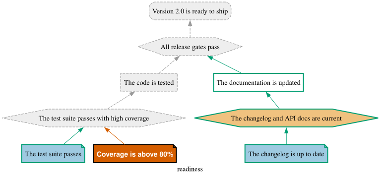

Arguments grow by composition. [`refine`](/tutorials/refine/) deepens one node into a whole
sub-argument, and [`assemble`](/tutorials/assemble/) joins finished arguments under a new
conclusion. On a real project, those parts rarely have a single author: the release team argues that
the release is ready, the QA team argues that the code is tested, and each team writes the checks
for its own part.

So when the parts are composed, who writes the step library of the composed argument? Mostly, nobody:
the runner runs the libraries written for the parts, together, on the composed model. This tutorial
shows how, first with `refine`, where no new code is needed at all, then with `assemble`, which needs
one small step.

This tutorial assumes the [Runner tutorial](/tutorials/runner/), and reuses the models of the
[refine](/tutorials/refine/) and [assemble](/tutorials/assemble/) tutorials as they are.
{: .notice--info}

# Two teams, two libraries

Put the three justifications of the [refine tutorial](/tutorials/refine/) (`draft`, `tested`, and
`readiness`, which refines one with the other) in `refine.jd`. Each team checks its own part.

The **release team** owns `draft`, the early argument in which testing is still a single piece of
evidence. Its library, `run/draft_steps.py`, checks the same two artifacts as in the
[Runner tutorial](/tutorials/runner/), plus the documentation strategy:

```python
# run/draft_steps.py
from pathlib import Path
from xml.etree import ElementTree

from jpipe_runner import Fail, Outcome, Pass, evidence, strategy

RELEASE = "2.0"


@evidence("draft:tests", observes={"report": "mock/junit.xml"}, produces=["tests_pass"])
def the_test_suite_passes(report: Path) -> Outcome:
    """[evidence] The test suite passes"""
    suite = ElementTree.parse(report).getroot()
    failed = int(suite.get("failures", "0")) + int(suite.get("errors", "0"))
    if failed == 0:
        return Pass(tests_pass=True)
    return Fail(f"{failed} tests failed")


@evidence("draft:changelog", observes={"changelog": "mock/CHANGELOG.md"}, produces=["changelog_ok"])
def the_changelog_is_up_to_date(changelog: Path) -> Outcome:
    """[evidence] The changelog is up to date"""
    if f"## {RELEASE}" in changelog.read_text(encoding="utf-8"):
        return Pass(changelog_ok=True)
    return Fail(f"the changelog has no entry for {RELEASE}")


@strategy("draft:docs", consumes=["changelog_ok"], produces=["docs_current"])
def the_changelog_and_api_docs_are_current(changelog_ok: bool) -> Outcome:
    """[strategy] The changelog and API docs are current"""
    return Pass(docs_current=changelog_ok)


@strategy("draft:gates", consumes=["tests_pass", "docs_current"])
def all_release_gates_pass(tests_pass: bool, docs_current: bool) -> Outcome:
    """[strategy] All release gates pass"""
    if tests_pass and docs_current:
        return Pass()
    return Fail("a release gate did not pass")
```

The **QA team** owns `tested`, the full argument that the code is tested. Its library,
`run/tested_steps.py`, reads the same test report, and a coverage measure as well:

```python
# run/tested_steps.py
from pathlib import Path
from xml.etree import ElementTree

from jpipe_runner import Fail, Outcome, Pass, evidence, strategy

THRESHOLD = 80.0


@evidence("tested:suite", observes={"report": "mock/junit.xml"}, produces=["suite_passes"])
def the_test_suite_passes(report: Path) -> Outcome:
    """[evidence] The test suite passes"""
    suite = ElementTree.parse(report).getroot()
    failed = int(suite.get("failures", "0")) + int(suite.get("errors", "0"))
    if failed == 0:
        return Pass(suite_passes=True)
    return Fail(f"{failed} tests failed")


@evidence("tested:coverage", observes={"measured": "mock/coverage.txt"}, produces=["coverage"])
def coverage_is_above_80(measured: Path) -> Outcome:
    """[evidence] Coverage is above 80%"""
    coverage = float(measured.read_text(encoding="utf-8"))
    if coverage > THRESHOLD:
        return Pass(coverage=coverage)
    return Fail(f"coverage is {coverage}%, not above {THRESHOLD}%")


@strategy("tested:testing", consumes=["suite_passes", "coverage"])
def the_test_suite_passes_with_high_coverage(suite_passes: bool, coverage: float) -> Outcome:
    """[strategy] The test suite passes with high coverage"""
    if suite_passes and coverage > THRESHOLD:
        return Pass()
    return Fail("the suite failed or coverage is too low")
```

Next to the `mock/junit.xml` and `mock/CHANGELOG.md` of the Runner tutorial, add the coverage the
QA team's evidence observes:

```
$ echo "92.5" > mock/coverage.txt
```

Each library was written, and runs, against its own model. Compile both, and the QA team, for one,
gets a green run of its argument:

```
$ jpipe process -i refine.jd -m draft -f JSON -o run/draft.jd.json
$ jpipe process -i refine.jd -m tested -f JSON -o run/tested.jd.json
$ jpipe-runner --library run/tested_steps.py run/tested.jd.json
Justification: tested
  The code is tested

  ✔ Evidence    The test suite passes                     # tested:suite
  ✔ Evidence    Coverage is above 80%                     # tested:coverage
  ✔ Strategy    The test suite passes with high coverage  # tested:testing
  ✔ Conclusion  The code is tested                        # tested:tested

4 elements (4 passed)
verdict: pass
```

# Running a refined argument

Now compile the composed `readiness`, and give the runner **both** libraries, each with its own
`--library`. Neither has been edited:

```
$ jpipe process -i refine.jd -m readiness -f JSON -o run/refined.jd.json
$ jpipe-runner --library run/draft_steps.py --library run/tested_steps.py run/refined.jd.json
Justification: readiness
  Version 2.0 is ready to ship

  ✔ Evidence        The changelog is up to date               # readiness:draft:changelog
  ✔ Strategy        The changelog and API docs are current    # readiness:draft:docs
  ✔ Sub-conclusion  The documentation is updated              # readiness:draft:documented
  ✔ Evidence        The test suite passes                     # readiness:tested:suite
  ✔ Evidence        Coverage is above 80%                     # readiness:tested:coverage
  ✔ Strategy        The test suite passes with high coverage  # readiness:tested:testing
  ✔ Sub-conclusion  The code is tested                        # readiness:hook
  ✔ Strategy        All release gates pass                    # readiness:draft:gates
  ✔ Conclusion      Version 2.0 is ready to ship              # readiness:draft:ready

JP008 warning [readiness:hook]: draft_steps.the_test_suite_passes is declared as evidence, and is bound to a sub-conclusion: it runs as a cross-check of the argument below it
  fix: Nothing to do for a cross-check. If the library serves only the composed model, declare the step with @sub_conclusion.

9 elements (9 passed)
1 diagnostic (1 warning)
verdict: pass
```

Three things happened, and each one is the runner doing the bookkeeping for you:

- **The ids changed, and the functions still bind.** Composition qualified every element with the
  composed justification's name: `draft:changelog` became `readiness:draft:changelog`. A function
  names an element by its full id *or* by a tail of it, as long as no other element ends the same
  way, so `@evidence("draft:changelog")` still finds its element. Write your checks against the parts,
  and they survive composition.
- **The refined node kept its old names.** The `tests` evidence of the draft (the `hook`) and the
  conclusion of `tested` became one element, the sub-conclusion `readiness:hook`, which still answers
  to both of its former ids as **aliases**. That is how the release team's
  `@evidence("draft:tests")` reached it.
- **That function now runs as a cross-check.** It was written for an evidence, and is now bound to a
  claim argued in full below it. The runner calls it *after* the QA team's argument, and only if that
  argument passed: the release team's quick check confirms what the detailed argument established.
  The **JP008** warning says so, rather than refusing to run.

# When one team's check fails

The point of running the parts together is that a failure in one team's argument reaches the
conclusion the other team cares about. Let coverage drop below the threshold:

```
$ echo "71.0" > mock/coverage.txt
$ jpipe-runner --library run/draft_steps.py --library run/tested_steps.py --diagram out/refined.svg run/refined.jd.json
Justification: readiness
  Version 2.0 is ready to ship

  ✔ Evidence        The changelog is up to date               # readiness:draft:changelog
  ✔ Strategy        The changelog and API docs are current    # readiness:draft:docs
  ✔ Sub-conclusion  The documentation is updated              # readiness:draft:documented
  ✔ Evidence        The test suite passes                     # readiness:tested:suite
  ✘ Evidence        Coverage is above 80%                     # readiness:tested:coverage
      tested_steps.coverage_is_above_80: coverage is 71.0%, not above 80.0%
      observed mock/coverage.txt (sha256 7853a8fb8a4e…, 5 bytes)
  - Strategy        The test suite passes with high coverage  # readiness:tested:testing
      not run: readiness:tested:coverage did not pass
  - Sub-conclusion  The code is tested                        # readiness:hook
      not run: readiness:tested:coverage did not pass
  - Strategy        All release gates pass                    # readiness:draft:gates
      not run: readiness:tested:coverage did not pass
  - Conclusion      Version 2.0 is ready to ship              # readiness:draft:ready
      not run: readiness:tested:coverage did not pass

JP008 warning [readiness:hook]: draft_steps.the_test_suite_passes is declared as evidence, and is bound to a sub-conclusion: it runs as a cross-check of the argument below it
  fix: Nothing to do for a cross-check. If the library serves only the composed model, declare the step with @sub_conclusion.

9 elements (1 failed, 4 skipped, 4 passed)
1 diagnostic (1 warning)
diagram: out/refined.svg
verdict: fail
```

The QA team's evidence failed, and the release is not ready: every element up to the release
team's conclusion is skipped, each naming `readiness:tested:coverage` as the element that stopped it.
The documentation branch, which does not depend on coverage, still passed.

<div align="center">

</div>

Set `mock/coverage.txt` back to `92.5` before going on.

**Strict runs.** `--strict` counts warnings as errors, so the JP008 cross-check above stops a strict
run before any step is called. If you want strict runs on the composed model, keep the cross-check
in a library that serves only that model, and declare it as what it now is:
`@sub_conclusion("readiness:hook")`.
{: .notice--info}

# Running an assembled argument

[`assemble`](/tutorials/assemble/) is different in one respect: it does not only rearrange the parts,
it **creates** reasoning of its own. Put the three justifications of the
[assemble tutorial](/tutorials/assemble/) (`tested`, `documented`, and `readiness`, which assembles
them) in `assemble.jd`. The `readiness` it builds has a new conclusion and a new strategy, *"All
release gates pass"*, that neither part contains, so neither team's library checks it.

The QA team's `run/tested_steps.py` serves as is. The `documented` argument gets its own library,
`run/documented_steps.py`, written like the draft's documentation checks:

```python
# run/documented_steps.py
from pathlib import Path

from jpipe_runner import Fail, Outcome, Pass, evidence, strategy

RELEASE = "2.0"


@evidence("documented:changelog", observes={"changelog": "mock/CHANGELOG.md"}, produces=["changelog_ok"])
def the_changelog_is_up_to_date(changelog: Path) -> Outcome:
    """[evidence] The changelog is up to date"""
    if f"## {RELEASE}" in changelog.read_text(encoding="utf-8"):
        return Pass(changelog_ok=True)
    return Fail(f"the changelog has no entry for {RELEASE}")


@strategy("documented:docs", consumes=["changelog_ok"])
def the_changelog_and_api_docs_are_current(changelog_ok: bool) -> Outcome:
    """[strategy] The changelog and API docs are current"""
    return Pass() if changelog_ok else Fail("the changelog is stale")
```

Run the two libraries on the assembled model, and the runner points straight at what is missing:

```
$ jpipe process -i assemble.jd -m readiness -f JSON -o run/assembled.jd.json
$ jpipe-runner --library run/tested_steps.py --library run/documented_steps.py run/assembled.jd.json
Justification: readiness
  Version 2.0 is ready to ship

JP005 error [readiness:assembleStrategy]: the strategy 'All release gates pass' has no step, so nothing checks it
  fix: Write its step: @strategy("readiness:assembleStrategy").

1 diagnostic (1 error)
verdict: invalid (nothing ran)
```

The strategy `assemble` created is called `readiness:assembleStrategy`, and every strategy needs a
step. Its job is small: a strategy runs only once everything below it has passed, so when it runs,
both assembled arguments already hold. A third library, owned by whoever assembled the argument,
says exactly that:

```python
# run/readiness_steps.py
from jpipe_runner import Outcome, Pass, strategy


@strategy("readiness:assembleStrategy")
def all_release_gates_pass() -> Outcome:
    """[strategy] All release gates pass"""
    # It runs only once both assembled arguments have passed.
    return Pass()
```

```
$ jpipe-runner --library run/tested_steps.py --library run/documented_steps.py --library run/readiness_steps.py run/assembled.jd.json
Justification: readiness
  Version 2.0 is ready to ship

  ✔ Evidence        The test suite passes                     # readiness:tested:suite
  ✔ Evidence        Coverage is above 80%                     # readiness:tested:coverage
  ✔ Strategy        The test suite passes with high coverage  # readiness:tested:testing
  ✔ Sub-conclusion  The code is tested                        # readiness:tested:tested
  ✔ Evidence        The changelog is up to date               # readiness:documented:changelog
  ✔ Strategy        The changelog and API docs are current    # readiness:documented:docs
  ✔ Sub-conclusion  The documentation is updated              # readiness:documented:documented
  ✔ Strategy        All release gates pass                    # readiness:assembleStrategy
  ✔ Conclusion      Version 2.0 is ready to ship              # readiness:assembleConclusion

9 elements (9 passed)
verdict: pass
```

You do not have to guess these generated ids: `jpipe process -m readiness -f PYTHON` on the
assembled model writes a skeleton with a stub for every element, including
`@strategy("readiness:assembleStrategy")`. Keep only the stubs no part's library covers.
{: .notice--info}

The division of labour is the same as for the arguments themselves. Each team owns the checks of its
own part, and they keep working however the parts are composed; the only code the composition asks
for is the reasoning the composition itself adds.

# Where to next?

- **[Templates](/tutorials/templates/)** capture an argument's shape for reuse; the libraries of the
  justifications that implement them are written and run just like the ones on this page.
- The runner's
  [step library reference](https://github.com/jpipe-mcscert/jpipe-runner/blob/main/docs/authoring.md#libraries-written-for-separate-models)
  says what libraries written for separate models need when they run together, and how an id
  designates an element.
